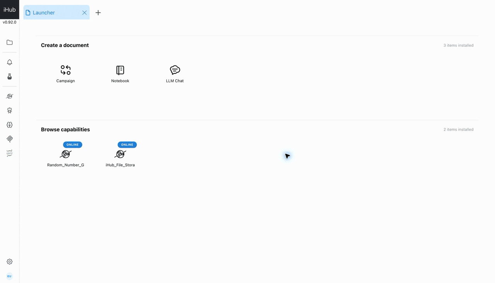

# Quick Start

This walkthrough creates a project, connects iHub to an INTERSECT server, and
runs a campaign with one capability node.

## Before you begin

You need:

- a signed-in iHub account.
- permission to create a project.
- the address, port, protocol, username, and optional password for an INTERSECT broker. 
- at least one live INTERSECT service advertising a capability.

If an INTERSECT server is already listed and connected in your project, skip
the connection fields below.

## 1. Create a project

1. Open the **Projects** page.
2. Select **New project**.
3. Enter a **Project Name**.
4. Optionally select an active user and grant **View** or **Edit** access.
5. Select **Create**, then open the new project from the project list.

The project opens to a launcher. Its **Create a document** section contains
Campaign, Notebook, and LLM Chat.

## 2. Connect an INTERSECT server

If a server is not already listed in the left navigation, contact
[ihub-support@ornl.gov](mailto:ihub-support@ornl.gov) through an approved
channel to request test-server access. You must be connected to the authorized
network to use the test server.

1. In the left navigation, open **INTERSECT Servers**.
2. If the required server is already listed, expand it and select **Connect**.
3. Otherwise, select **Create new INTERSECT broker** and enter:
   - a name
   - the broker IP address and port
   - `amqp0.9.1` or `mqtt5.0`
   - the broker username and optional password
   - the orchestrator URL and API key when campaign orchestration requires them
4. Save the connection and select **Connect**.
5. Confirm that the server status is **connected**. Expand it to verify that
   iHub discovered the expected services and capabilities.

See [INTERSECT Servers](configuration/intersect-servers.md) if the connection
does not become available.

## 3. Create a campaign

1. Return to the project launcher.
2. Under **Create a document**, select **Campaign**.
3. In **Set up your campaign**, select the connected **INTERSECT instance**.
4. Select **Create first task group**.

iHub creates an `.icmp` project file and opens the Campaign Builder. Changes to
the document are saved automatically after a short delay.

## 4. Add a capability

1. Open the task group tab.
2. Select **Add node** in the campaign toolbar.
3. Under **Services**, select a service, a capability, and then an endpoint.
4. Complete the capability inputs:
   - use **Custom** for a value entered directly; or
   - use **Upstream** after connecting an output from another node.
5. If you add multiple nodes, connect compatible output and input handles.

A campaign needs at least one capability node before it can run.

## 5. Run and inspect the campaign

1. Confirm that the selected INTERSECT server still shows **connected**.
2. Set **Campaign iterations** to `1`.
3. Select **Run campaign**.
4. Watch the node status badges as work moves from waiting to executing and
   then to complete or error.
5. Open **Active Experiments** in the left navigation to see the run ID,
   broker, start time, and current status.

Use **Stop campaign** if you need to end an active run. iHub asks for
confirmation before sending the stop request.

## 6. Simple demo campaign

This demo uses the `generate_random_list` endpoint to generate 10 values and
connects its output to a **Line Chart**. The visualization uses **Value** for
both axes before the campaign is run.

## Next steps

- Add more node types with the
  [Campaign Builder guide](applications/campaign-builder.md).
- Configure a kernel and work through the
  [Notebook guide](applications/notebook.md).
- Configure an agent and start a conversation with the
  [Chat guide](applications/chat.md).
